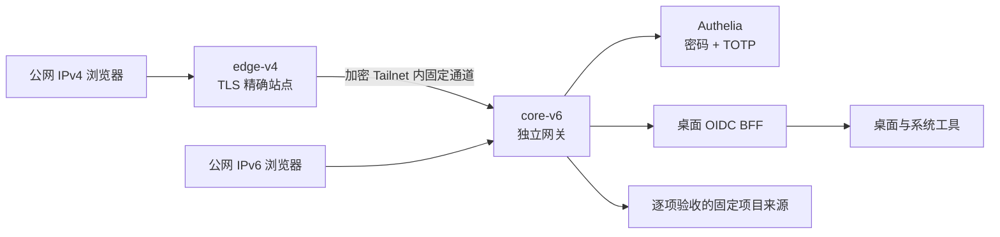

# 万点飞花 · 个人集群 Web OS 实践手册

让分散在多台机器上的服务成为桌面里的 App：先用密码和 Authenticator 六位动态码登录，再在可拖动、缩放、并排的窗口中打开和管理项目。

这是项目的**脱敏实践记录、架构说明、部署教程和运维流程**。当前仓库包含文档和拓扑输入示例，不包含完整桌面/BFF源码、生产发行包或个人集群配置；克隆本仓库不会直接启动一套 Web OS。教程会标明需要自己实现或准备的应用组件，以及哪些能力尚未完成。

## 先看当前状态

截至 **2026-10-19**：

MeshCentral 已接入桌面与服务端加密钥匙串，发布后当前版本与三项服务复核通过。既有 SSO 自动续接，无需再次输入密码；真实窗口显示原生管理员身份，先前失败的脚本和图标均返回成功，控制 WebSocket 握手为 `101`。iframe 内实际 Ctrl＋K 打开 OS Spotlight，白区真实右键出现万点飞花菜单，靠左并排通过。**原生页面当前显示暂无设备组或在线 Agent，因此没有把远程桌面、终端或设备文件操作写成通过；本轮也未重跑真实 Mesh 锁定撤销。** 会话隔离、两次页面故障与修复、精确回退和 Bun 硬链接兼容的经验见[把远程管理接入 OS 的会话边界](docs/13-mesh-native-sessions-and-release.md)。

最新系统交互升级已由助手通过私密凭据通道自动发布，当前版本与三项服务复核通过。新增六种窗口布局、拖边预览、尺寸还原、不会被小窗口裁切的布局菜单，以及连续程序坞动效与玻璃材料分层。真实拖动、四分布局、还原、焦点和减弱动效已在隔离浏览器验证；公网已看到新增 Minecraft、活动监视器、Tailnet 设备与隧道客户端状态原生窗口。Minecraft 复用既有 MCS 服务端钥匙串，其他原生窗口按各自真实来源读取；不把这些只读视图叫作全部管理员接入。实现、故障与验收方法见[从窗口布局到原生系统应用](docs/12-native-system-apps.md)。

新一轮桌面与原生解锁升级已由本人执行合并入口激活，发行包核验、BFF/身份配置检查、服务启动与自动匿名边界检查返回通过。独立只读复核确认当前发行与三项服务正常，外部 IPv4 六站可信 TLS、认证页及五个受保护入口跳转通过。**本人已确认新版密码＋Authenticator 解锁，正常会话中真实桌面、四原生项目页面、实时总览、文件与搜索工作流已验证。** 各项证据范围与未完项见[桌面体验与开机解锁](docs/09-os-experience-and-unlock.md)，不把历史协议测试或本轮页面观察泛化为全部管理功能。

随后，输入体验升级先由本人部署；缓存修复版再通过获授权工具自动发布，当前版本与三项服务复核通过，既有 SSO 自动返回桌面。MCSManager、NetAlertX、Harness、Zashboard 均重新确认受管桥存在、焦点位于原应用 iframe，并以实际 Ctrl＋K 打开桌面搜索。Zashboard 经原生工具栏正常刷新、首页仍由 Service Worker 缓存返回后，再次通过该检查；完整热键与业务矩阵继续验收。

公网还已有限验证菜单进入全屏、帮助页重复 F11 保持状态、Esc 退出，以及 Ctrl＋Shift＋D 显示桌面和桌面自有右键菜单。当前内置浏览器拒绝增强键盘锁，界面显示真实降级状态；系统与浏览器保留的按键继续遵守宿主边界。

为减少后续反复复制提权命令，[本机私密凭据与固定 sudo 动作](docs/11-private-sudo-automation.md)现已实机启用：本人完成隐藏输入、准确读回和启用，助手独立加载保存值完成只读提权检查、无重启版本复核及一次审核后的自动发布。发布后当前版本与三项服务复核通过，无需本人再复制 sudo 命令。此前跨 PowerShell 宿主的模块加载故障与修复过程保留在教程中；29 项检查、20 个完整场景的双版本 PowerShell 证据与真实调用结果分别记录。

| 部分 | 已有证据 | 尚需完成 |
| --- | --- | --- |
| 桌面体验 | 新版总览往返、第二桌面创建后 Dock 寻回原窗口、后续文件工作中，四个项目 iframe 的实际节点身份保持一致；系统设置实际加载及左右平铺通过 | 完整桌面容量、布局组与全部外观偏好路径继续验收；相同 iframe 不等同 WS 长稳，不声称全部 macOS 效果 |
| 公网登录与锁定 | 本人确认新版密码 + Authenticator 解锁，实际浏览器显示真实新版桌面；未代输凭据。旧版实际锁定关闭既有连接与随后新登录的证据保留 | 新版退出重登、同意页省去的完整轨迹、缺码/错码/过期码、恢复、旧凭据重放与完整身份生命周期仍待验收 |
| 此前四项目窗口 | 新版正常会话中 MCSManager 实例列表/终端页、NetAlertX 设备表、Zashboard 代理页与 Harness 工作区均无需再输原站密码；未执行命令或实例写入 | 该阶段未重新测 WS101/长期稳定；原站自动下载弹窗、独立节点连接测试、全部管理动作和其他生命周期待完善。此前 MCSManager 原生传输与 Zashboard 数据流证据按原阶段保留 |
| MeshCentral 新接入 | 公网原生管理员页面、依赖脚本及图标、控制 WS101、iframe 焦点下 Ctrl＋K、桌面右键与靠左并排通过；本阶段前次发布已核对最小化与 Dock 恢复保持同一 iframe DOM 节点与焦点 | 原站无设备组或在线 Agent，真实远控、终端、设备文件待验收；本轮真实 Mesh 锁定未重跑，合成双 WS 撤销证据单独保留 |
| 统一钥匙串 | 服务端加密库、三项既有 Bearer 与 MeshCentral 原生身份材料已部署；Mesh 使用私密原生会话与句柄映射，正常窗口授权通过。可选 password/oidc-client 缺失不影响当前适配器，现场 Harness 采用工作区授权而无需库记录 | 完整撤销、凭据轮换与恢复继续验收；页面数据不代替管理动作 |
| 生产身份与 TLS | 身份材料、双入口可信证书安装完成 | SMTP实际投递、续期自动化与恢复演练 |
| 早期配置验证 | 较早的受审配置曾通过 BFF、证书、Authelia、Caddy 四阶段实际校验 | 不能把旧结果沿用为新版本的现场通过证明 |
| 较早公网发布的现场验证 | 首轮因 BFF 的 `INVALID_NODE_ENV` 停止；本人恢复执行时环境已为规范值、无需修改，四阶段重校验全部通过 | 首次失败原因仍不能唯一归因，不能把合成引号复现当作现场原因 |
| 此前公网激活 | 本人合并升级与独立现场版本/三服务复核通过；该阶段外部 IPv4 六站 CA 可信 TLS、认证页 200，桌面及四 App 匿名 HTML 请求均 302 至认证；随后本人解锁并完成已列正常会话检查，该阶段未改 DNS | 外部 IPv6 请求未通过，SMTP 与其他身份/应用生命周期继续验收 |
| 节点、文件、任务 | 新版真实测试文本创建、编辑、保存、Quick Look 与下载逐字节一致；真实扫描完成且统计与目录相符；既有文件和已完成任务在升级后保留；Spotlight 根目录文件结果经 Enter 打开文本一致 | 未保存关窗 sheet 默认取消且返回时编辑保留，本次未证明全部取消分支；排队/运行中恢复、任务取消、权限边界与远端管理仍待，原站自动弹窗另验 |

旧配置通过、首轮失败、恢复重校验、新版激活和本人功能验收分别记录。此前 MCSManager 原生终端/文件传输、Zashboard 有限持续数据流及实际锁定撤销有独立证据，历史过程见[钥匙串与多桌面](docs/08-keychain-and-spaces.md)。前述四项目正常会话阶段补齐了新版页面、iframe 节点连续性和已列文件/任务工作流，当时未重新验证 WS101、退出或长期连接。新增 MeshCentral 的控制握手与输入验收另记于[本次接入记录](docs/13-mesh-native-sessions-and-release.md)，不能外推为其他通道通过。完整目标与未完成项见 [ROADMAP](ROADMAP.md)。

## 架构

IPv4 由边缘节点接入，IPv6 直接进入核心节点；两条路径共用身份和应用策略。Tailnet 解决节点连接，用户仍需认证。macOS 用作桌面交互参考，这个项目没有运行或分发 macOS。当前官方版本与能力对照见[macOS 与 Web OS 进展](docs/07-macos-and-os-state.md)。

## 阅读顺序

1. [架构与组件边界](docs/01-architecture.md)：桌面、网关、BFF、身份与原应用分别负责什么。
2. [项目经历与决策记录](docs/02-build-journal.md)：从导航面板转向桌面，真实应用、身份迁移、证书和版本错配的教训。
3. [从准备到验收的教程](docs/03-tutorial.md)：按依赖完成实现、配置、部署和逐项验收。
4. [日常运维与发布流程](docs/04-operations.md)：版本、证书、地址变化、发布、回退和故障处理。
5. [排错手册](docs/05-troubleshooting.md)：用证据定位问题，避免反复输入凭据和盲目重跑初始化。
6. [需求与路线图](ROADMAP.md)：保留全部产品目标，区分已完成、已验证与待实现。
7. [文档公开与更新流程](docs/06-publication-process.md)：如何脱敏、检查Git内容并维护真实进度。
8. [macOS 基线与当前 OS 能力](docs/07-macos-and-os-state.md)：窗口总览、真实运行时、验证证据，以及仍需后端或受到浏览器限制的能力。
9. [钥匙串与多桌面](docs/08-keychain-and-spaces.md)：一次解锁、原站协议适配、真实凭据导入、密钥泄漏回归和合并发布经验。
10. [桌面体验与开机解锁](docs/09-os-experience-and-unlock.md)：原生认证外观、实时总览、Finder、Spotlight 与合并发布；本人已解锁，新版正常会话验收与仍待验证的边界。
11. [全屏、快捷键与右键菜单](docs/10-fullscreen-shortcuts-and-context-menus.md)：四个真实项目的原站焦点 Ctrl＋K 与正常缓存刷新已验证；完整热键、菜单和全屏矩阵继续验收。
12. [本机私密凭据与固定 sudo 动作](docs/11-private-sudo-automation.md)：隐藏输入、DPAPI 暂存与启用、有限审核动作与超时处理；本人登记、独立加载及自动发布已实际通过。
13. [从窗口布局到原生系统应用](docs/12-native-system-apps.md)：窗口几何、弹层与焦点、材料和动效，以及复用钥匙串的受保护原生数据接口。
14. [把远程管理接入 OS 的会话边界](docs/13-mesh-native-sessions-and-release.md)：MeshCentral 已上线，原生身份、控制握手及桌面输入已验证；记录服务端 Cookie 与不透明句柄、撤销边界、精确回退及公开包硬链接的窄例外，真实设备业务仍待验收。

输入示例见 [examples/topology.env.example](examples/topology.env.example)。示例中的 `example.net`、文档 IPv4/IPv6 和 Tailnet 地址都是占位说明，不是可访问的部署。

## 这次实践最重要的改进

- 把基础调查做在部署前：每台机器都核对实际二进制版本，不能用另一台主机的验证结果替代。
- 先完成可重复的阶段检查，再把同一阶段合并为一次执行；让操作者看到明确的失败组件，减少来回粘贴命令。
- 密码、TOTP密钥、SMTP授权码、DNS Token、私钥和账号数据库始终留在操作者控制的环境；公开内容重新编写，不上传原始日志。
- 按真实项目验证 HTTP、WebSocket、文件传输、嵌入、原站授权与注销，不用一个 `200 OK` 代表接入成功。
- 将候选核验、配置检查、选择、启动和结果汇总组织成一次本人提权发布；首轮在失败关卡停止，本人恢复时先分类并重校验，再完成激活。规范环境保持不动，没有为了消除错误而强行改值；全部业务仍需分别验收。

## 脱敏范围

仓库不包含真实域名、地址、主机/SSH标识、账号邮箱、个人文件路径、原始对话、生产日志、身份数据、证书或密钥。真实部署只能使用自己核对的输入，示例不能原样用于生产。公开文档中的产品名、开源组件名、验证版本和标准协议保留，以便解释技术选择。

后续进度以本仓库的状态表和路线图为准；未通过实际验收的能力不会标为完成。
