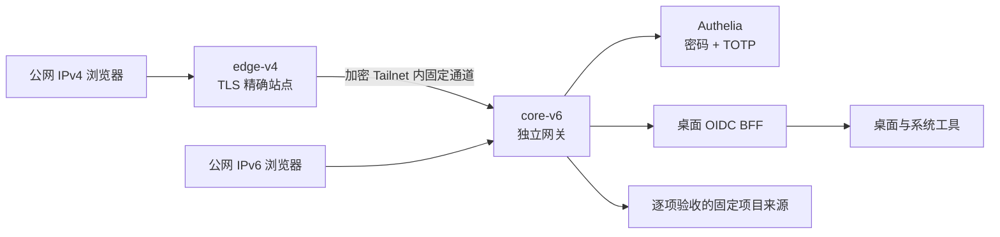

# 万点飞花 · 个人集群 Web OS 实践手册

让分散在多台机器上的服务成为桌面里的 App：先用密码和 Authenticator 六位动态码登录，再在可拖动、缩放、并排的窗口中打开和管理项目。

这是项目的**脱敏实践记录、架构说明、部署教程和运维流程**。当前仓库包含文档和拓扑输入示例，不包含完整桌面/BFF源码、生产发行包或个人集群配置；克隆本仓库不会直接启动一套 Web OS。教程会标明需要自己实现或准备的应用组件，以及哪些能力尚未完成。

## 先看当前状态

截至 **2026-10-19**：

| 部分 | 已有证据 | 尚需完成 |
| --- | --- | --- |
| 桌面体验 | 本地桌面、应用图标、搜索、Dock、多窗口、布局保存 | 持续打磨交互和无障碍体验 |
| 本地登录 | 密码 + Authenticator TOTP；原绑定已迁移到独立生产身份库 | 公网真实登录、错误码拒绝、恢复和注销验收 |
| 真实项目窗口 | 四个项目的真实页面已在本地窗口验证 | 原应用业务登录、管理动作、传输与公网逐项验收 |
| 生产身份与 TLS | 身份材料、双入口可信证书安装完成 | SMTP实际投递、续期自动化与恢复演练 |
| 生产配置 | 专用 Caddy 已升级；BFF、证书、Authelia、Caddy 四阶段实际校验均通过 | 新 Web OS 服务尚未启动，入口 A/AAAA 尚未切换 |
| 节点、文件、任务 | 系统工具界面及本地沙盒 | 生产集群的真实后端、授权动作、持久任务和审计 |

配置通过不等于上线成功。本地页面能打开，也不等于所有项目已经支持嵌入、管理和统一注销。完整目标与未完成项见 [ROADMAP](ROADMAP.md)。

## 架构

IPv4 由边缘节点接入，IPv6 直接进入核心节点；两条路径共用身份和应用策略。Tailnet 解决节点连接，用户仍需认证。macOS 用作桌面交互参考，这个项目没有运行或分发 macOS。

## 阅读顺序

1. [架构与组件边界](docs/01-architecture.md)：桌面、网关、BFF、身份与原应用分别负责什么。
2. [项目经历与决策记录](docs/02-build-journal.md)：从导航面板转向桌面，真实应用、身份迁移、证书和版本错配的教训。
3. [从准备到验收的教程](docs/03-tutorial.md)：按依赖完成实现、配置、部署和逐项验收。
4. [日常运维与发布流程](docs/04-operations.md)：版本、证书、地址变化、发布、回退和故障处理。
5. [排错手册](docs/05-troubleshooting.md)：用证据定位问题，避免反复输入凭据和盲目重跑初始化。
6. [需求与路线图](ROADMAP.md)：保留全部产品目标，区分已完成、已验证与待实现。
7. [文档公开与更新流程](docs/06-publication-process.md)：如何脱敏、检查Git内容并维护真实进度。

输入示例见 [examples/topology.env.example](examples/topology.env.example)。示例中的 `example.net`、文档 IPv4/IPv6 和 Tailnet 地址都是占位说明，不是可访问的部署。

## 这次实践最重要的改进

- 把基础调查做在部署前：每台机器都核对实际二进制版本，不能用另一台主机的验证结果替代。
- 先完成可重复的阶段检查，再把同一阶段合并为一次执行；让操作者看到明确的失败组件，减少来回粘贴命令。
- 密码、TOTP密钥、SMTP授权码、DNS Token、私钥和账号数据库始终留在操作者控制的环境；公开内容重新编写，不上传原始日志。
- 按真实项目验证 HTTP、WebSocket、文件传输、嵌入、原站授权与注销，不用一个 `200 OK` 代表接入成功。

## 脱敏范围

仓库不包含真实域名、地址、主机/SSH标识、账号邮箱、个人文件路径、原始对话、生产日志、身份数据、证书或密钥。真实部署只能使用自己核对的输入，示例不能原样用于生产。公开文档中的产品名、开源组件名、验证版本和标准协议保留，以便解释技术选择。

后续进度以本仓库的状态表和路线图为准；未通过实际验收的能力不会标为完成。
