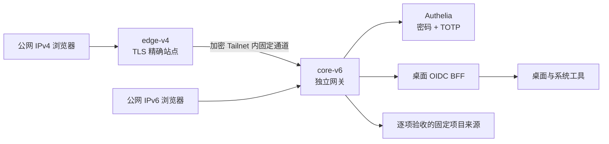

# 万点飞花 · 个人集群 Web OS 实践手册

让分散在多台机器上的服务成为桌面里的 App：先用密码和 Authenticator 六位动态码登录，再在可拖动、缩放、并排的窗口中打开和管理项目。

这是项目的**脱敏实践记录、架构说明、部署教程和运维流程**。当前仓库包含文档和拓扑输入示例，不包含完整桌面/BFF源码、生产发行包或个人集群配置；克隆本仓库不会直接启动一套 Web OS。教程会标明需要自己实现或准备的应用组件，以及哪些能力尚未完成。

## 先看当前状态

截至 **2026-10-19**：

| 部分 | 已有证据 | 尚需完成 |
| --- | --- | --- |
| 桌面体验 | 公网新建第二桌面、移入 NetAlertX 后恢复真实设备表、关闭新桌面保留八窗口已通过；总览并排有实际证据，Dock 寻回与刷新恢复已在本地验证 | 完整八桌面容量、布局组、统一命令搜索等继续验收；不由移窗推断 iframe 身份或连接连续，不声称全部 macOS 效果 |
| 公网登录与锁定 | 本人密码 + Authenticator 正向登录已有证据；本轮实际锁定关闭既有 MCSManager 与 Zashboard 连接，原生页刷新回认证 | 本次锁定后的本人重登、缺码/错码/过期码、恢复、旧凭据重放与完整身份生命周期仍待验收 |
| 真实项目窗口 | 第三次修复已部署；四个原站页面通过，MCSManager 真实终端及分片上传下载哈希一致、Zashboard 实际数据流已验证；边缘修复后两者有限持续观察越过旧断连点，实际锁定关闭既有连接 | 自动下载弹窗、独立节点连接测试、全部管理动作和其他生命周期待完善；不把有限观察写成长期稳定 |
| 统一钥匙串 | 服务端加密库与三项真实 Bearer 已部署，正常窗口授权通过；可选 password/oidc-client 缺失不影响当前适配器，现场 Harness 采用工作区授权而无需库记录 | 完整撤销、凭据轮换与恢复继续验收；页面数据不代替管理动作 |
| 生产身份与 TLS | 身份材料、双入口可信证书安装完成 | SMTP实际投递、续期自动化与恢复演练 |
| 早期配置验证 | 较早的受审配置曾通过 BFF、证书、Authelia、Caddy 四阶段实际校验 | 不能把旧结果沿用为当前候选的现场通过证明 |
| 较早公网发布的现场验证 | 首轮因 BFF 的 `INVALID_NODE_ENV` 停止；本人恢复执行时环境已为规范值、无需修改，四阶段重校验全部通过 | 首次失败原因仍不能唯一归因，不能把合成引号复现当作现场原因 |
| 公网激活 | 当前独立发行与三项服务正常；边缘修复后的外部 IPv4 六站可信 TLS、MFA 跳转和四项目匿名 broker 拒绝检查通过；本轮未改 DNS | 主入口停留认证页，等待本人重登；外部 IPv6 请求未通过，SMTP 与其他应用业务继续验收 |
| 节点、文件、任务 | 实际核心指标、文件读写与任务保留已验证；OS 真实上传下载哈希一致，新扫描与目录相符；本次发布重启后文件和已完成任务仍可见 | 排队/运行中恢复、取消和权限边界待验收；远端管理未开放，原站自动弹窗与其他传输边界另验 |

旧配置通过、首轮失败、恢复重校验、新版激活和本人功能验收分别记录。第三次修复后，MCSManager 正常原生终端和测试文件传输通过，实例保持停止；边缘修复后 MCSManager 与 Zashboard 连接越过旧断连点，实际锁定关闭既有连接。主入口当前等待本人重新登录；自动下载弹窗与其他未列生命周期仍待完善，过程见[钥匙串与多桌面](docs/08-keychain-and-spaces.md)。完整目标与未完成项见 [ROADMAP](ROADMAP.md)。

## 架构

IPv4 由边缘节点接入，IPv6 直接进入核心节点；两条路径共用身份和应用策略。Tailnet 解决节点连接，用户仍需认证。macOS 用作桌面交互参考，这个项目没有运行或分发 macOS。当前官方版本与能力对照见[macOS 与 Web OS 进展](docs/07-macos-and-os-state.md)。

## 阅读顺序

1. [架构与组件边界](docs/01-architecture.md)：桌面、网关、BFF、身份与原应用分别负责什么。
2. [项目经历与决策记录](docs/02-build-journal.md)：从导航面板转向桌面，真实应用、身份迁移、证书和版本错配的教训。
3. [从准备到验收的教程](docs/03-tutorial.md)：按依赖完成实现、配置、部署和逐项验收。
4. [日常运维与发布流程](docs/04-operations.md)：版本、证书、地址变化、发布、回退和故障处理。
5. [排错手册](docs/05-troubleshooting.md)：用证据定位问题，避免反复输入凭据和盲目重跑初始化。
6. [需求与路线图](ROADMAP.md)：保留全部产品目标，区分已完成、已验证与待实现。
7. [文档公开与更新流程](docs/06-publication-process.md)：如何脱敏、检查Git内容并维护真实进度。
8. [macOS 基线与当前 OS 能力](docs/07-macos-and-os-state.md)：窗口总览、真实运行时、验证证据，以及仍需后端或受到浏览器限制的能力。
9. [钥匙串与多桌面](docs/08-keychain-and-spaces.md)：一次解锁、原站协议适配、真实凭据导入、密钥泄漏回归和合并发布经验。
10. [桌面体验与开机解锁](docs/09-os-experience-and-unlock.md)：新一轮本地候选的原生认证外观、同一窗口实时总览、Finder、Spotlight 与一次合并发布；新版本公网部署和完整体验验收待完成。

输入示例见 [examples/topology.env.example](examples/topology.env.example)。示例中的 `example.net`、文档 IPv4/IPv6 和 Tailnet 地址都是占位说明，不是可访问的部署。

## 这次实践最重要的改进

- 把基础调查做在部署前：每台机器都核对实际二进制版本，不能用另一台主机的验证结果替代。
- 先完成可重复的阶段检查，再把同一阶段合并为一次执行；让操作者看到明确的失败组件，减少来回粘贴命令。
- 密码、TOTP密钥、SMTP授权码、DNS Token、私钥和账号数据库始终留在操作者控制的环境；公开内容重新编写，不上传原始日志。
- 按真实项目验证 HTTP、WebSocket、文件传输、嵌入、原站授权与注销，不用一个 `200 OK` 代表接入成功。
- 将候选核验、配置检查、选择、启动和结果汇总组织成一次本人提权发布；首轮在失败关卡停止，本人恢复时先分类并重校验，再完成激活。规范环境保持不动，没有为了消除错误而强行改值；全部业务仍需分别验收。

## 脱敏范围

仓库不包含真实域名、地址、主机/SSH标识、账号邮箱、个人文件路径、原始对话、生产日志、身份数据、证书或密钥。真实部署只能使用自己核对的输入，示例不能原样用于生产。公开文档中的产品名、开源组件名、验证版本和标准协议保留，以便解释技术选择。

后续进度以本仓库的状态表和路线图为准；未通过实际验收的能力不会标为完成。
