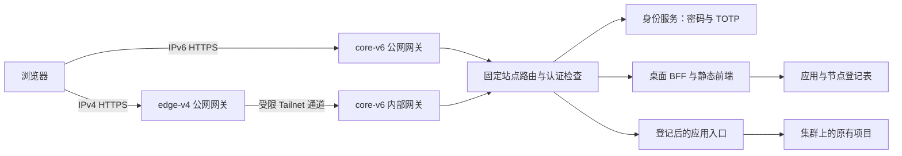
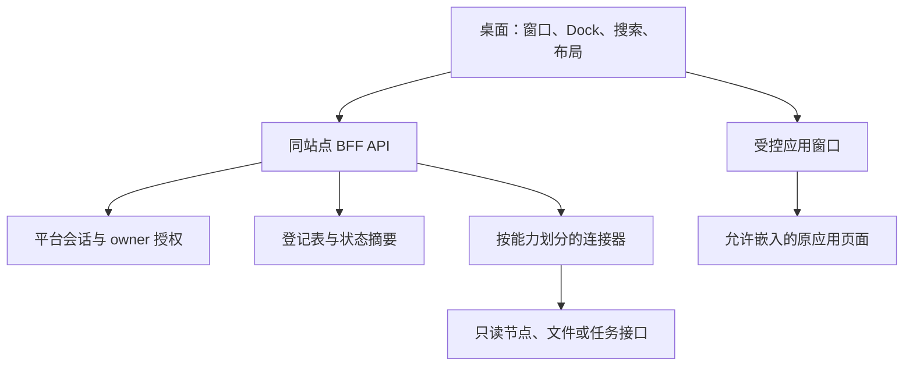
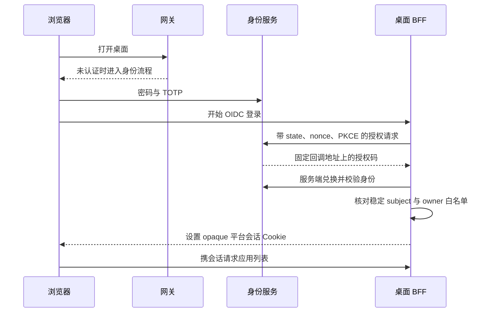

# 万点飞花：集群 Web OS 架构

万点飞花的目标，是让一个人通过公网入口，用密码和 Authenticator 动态码登录，在浏览器里的桌面窗口中使用自己的集群项目。

这里的 Web OS 指统一的桌面交互、应用入口、身份边界和运维界面。它运行在已有操作系统与服务之上；节点调度、文件系统和项目管理能力，需要各自真实的后端接口与权限设计。

**本仓库公开的是实施手册、设计取舍和脱敏示例。应用源码、可执行文件、前端构建产物及私有部署工具不在本次公开范围。克隆仓库后不能直接运行桌面，也不存在可供执行的 `bun start`。** 需要先准备或自行实现下文中的桌面前端、BFF、应用连接器及部署产物，再把手册用于实施。

## 1. 目标体验与当前证据

桌面采用熟悉的桌面系统交互：顶部菜单栏、底部 Dock、应用图标、多窗口、左上角窗口控制按钮，以及居中的窗口标题。透明材质主要用于菜单栏、Dock 和窗口外壳，正文、表格和表单保持清晰。该视觉方向可以参考 macOS 的交互语言及 [Apple 窗口设计指南](https://developer.apple.com/design/human-interface-guidelines/windows)，图标、壁纸和实现应使用自己拥有许可的素材。

用户从桌面启动已登记的项目，而不是记住每台机器的端口。窗口负责焦点、拖动、缩放、最小化和恢复；应用自己的业务界面和登录机制继续存在。桌面需要同时提供键盘操作、可见焦点、减少动画选项，以及小屏幕上的单窗口使用方式。

本项目记录的状态，不能合并成一个含糊的“已完成”：

| 范围 | 已有证据 | 尚不能据此声称的结果 |
| --- | --- | --- |
| 桌面 UI 与窗口管理 | 公网窗口总览搜索、键盘恢复实际焦点与左右并排已验证，基础桌面和窗口交互已实现 | 全部 macOS 效果、Spaces 或所有应用业务均已可用 |
| 真实项目窗口 | 四个受保护候选在公网加载预期原站页面 | 原站业务登录、写入、管理、终端或传输已验收 |
| 节点、文件、任务 | 受限后端已生产部署；公网实际节点状态、文件创建编辑回读、目录扫描和刷新后任务保留已验证 | 任意节点终端、任意文件、任意命令权限或完整任务生命周期已验收 |
| 早期配置 | 较早的受审配置曾通过四阶段实际检查 | 当前候选也必然通过现场校验 |
| 当前候选配置 | 首轮 BFF 失败；本人恢复时环境规范且未修改，四阶段重校验通过 | 已唯一确定首轮失败原因 |
| 公网发布 | 核心、边缘与业务 DNS 已启用；自动检查、本人密码加 TOTP 正向登录和主动锁定重登通过 | 负向认证、SMTP 投递、完整注销、独立外部 IPv6 及应用管理均已验收 |

截至本文记录，核心与边缘及业务 DNS 已实际启用，相关服务和自动检查通过。首轮 BFF 曾以 `INVALID_NODE_ENV` 拒绝；本人恢复时文件与服务用户进程中的值均已符合要求，未修正该值，四阶段重校验后才继续激活。初次原因不能唯一归因。旧检查、首轮失败、本次恢复和待做业务验收分别保留，不能互相覆盖。

这次配置验证使用的版本为：核心专用网关 Caddy **2.11.7**、边缘既有网关 Caddy **2.11.4**、身份服务 Authelia **4.39.28**。本次升级仅涉及核心的新 Web OS 专用网关，边缘保留原有版本。它们是验证基线，不能当作永远最新或适用于所有后续版本的保证。升级前应重新核对官方说明并验证目标机器实际使用的二进制。

## 2. 双入口、一套身份和应用策略

示例将两台机器称为 `edge-v4` 与 `core-v6`。地址均为文档示例，不能作为实际部署地址使用。

| 角色或入口 | 示例值 | 职责 |
| --- | --- | --- |
| 桌面入口 | `https://os.example.net` | 桌面、BFF 和平台会话 |
| 身份入口 | `https://auth.os.example.net` | 密码、TOTP、OIDC 与身份会话 |
| `edge-v4` 公网 IPv4 | `192.0.2.10` | 接受 IPv4 HTTPS，经 Tailnet 到核心网关 |
| `edge-v4` 局域网地址 | `192.0.2.20` | 展示环境清点所需的地址分类，不作为公网解析值 |
| `edge-v4` Tailnet 地址 | `100.64.0.20` | 固定的内部转发来源 |
| `core-v6` Tailnet 地址 | `100.64.0.10` | 接受受限的内部网关请求 |
| `core-v6` 公网 IPv6 | `2001:db8:120::10` | 直接接受 IPv6 HTTPS |

两条公网路线最终应用同一套访问策略。内部入口只接受预期的边缘节点与固定站点，不能成为通用 HTTP 代理。Tailnet 提供网络连通性，浏览器访问仍需经过身份认证、平台授权和应用自身的权限校验。

IPv4 边缘与 IPv6 核心都终止 HTTPS，因此两端都需要正确的证书、私钥、完整链及访问权限。内部传输可以选择受限 HTTP 或带正确服务身份校验的 HTTPS；必须明确选择及其信任边界，不能以关闭证书验证代替配置。

客户端地址只能信任已登记代理写入的转发头。来源不在信任列表的请求，不能仅凭自行填写的转发头获得权限。原有网站和已有网关应保留自己的监听、配置和证书；新增入口先独立检查，再合并检查。

## 3. 浏览器桌面与 BFF 的分工

前端可以保存窗口位置、主题等不敏感偏好。身份令牌、项目凭据和节点管理密钥不能放进浏览器存储、静态构建产物或前端环境变量。

BFF 是浏览器和后端服务之间的专用接口，负责会话、应用登记、授权、输入限制、审计与受控连接。不能提供一个由浏览器传入任意目标 URL、路径或命令的“万能接口”。

建议把项目登记表设计为默认拒绝：

| 字段 | 用途 |
| --- | --- |
| 稳定应用标识、标题、图标、分类 | 桌面展示与稳定链接，避免把节点地址当应用身份 |
| 所属节点角色与负责人 | 表明项目在哪里运行、由谁维护 |
| 经核实的规范来源 | 上游实际期望的协议、Host 和 Origin |
| 传输目标 | Tailnet 地址、内部名称或本机隧道，和规范来源分开记录 |
| 启动路径、探测路径、WebSocket 路径 | 使用实际部署证据确认的路径 |
| 嵌入模式与允许来源 | 明确使用 iframe、独立来源代理或受限外部打开 |
| 原应用认证、允许操作、接入状态 | 区分只读连接与已经验收的管理能力 |

界面只展示状态已经核实的启动方式。入口不明、来源不可信或尚未获准嵌入的项目，可以显示为受限卡片并解释原因，不能用一个返回 HTTP 200 的陌生端口冒充接通。

## 4. 密码、Authenticator 与 OIDC

Authenticator 在本文中特指手机验证器生成的 TOTP 六位动态码。它依赖共享密钥和准确时间。平台登录政策应要求密码与 TOTP 两个因素，而不只是“用户曾经登记过验证器”。

网关的身份检查与 BFF 的 OIDC 登录解决不同问题：前者限制进入受保护站点，后者把经过验证的身份绑定到平台自己的权限和会话。Caddy 的预认证机制参见官方 [forward_auth 文档](https://caddyserver.com/docs/caddyfile/directives/forward_auth)。不能把来自普通请求头的用户名当作可信 owner 身份。

BFF 应使用成熟的 OIDC 库；客户端认证、回调和双因素策略应对照 [Authelia OIDC 客户端配置](https://www.authelia.com/configuration/identity-providers/openid-connect/clients/)核对，并具备这些边界：

- 只接受固定 HTTPS issuer 的可信发现结果，使用固定 client、回调地址和服务端 client secret。
- 校验 state、nonce、PKCE S256、签名、issuer、audience、有效期；身份服务对该客户端强制双因素，BFF 按已验证的协议核对该版本返回的认证方法声明。
- 用稳定 subject 做单 owner 白名单。邮箱和显示名称可变化，不能独自承担授权决定。
- 回调状态短时有效且只能消费一次；失败时不能沿用未完成登录的状态。
- 浏览器只获得随机 opaque 会话 Cookie；Cookie 使用 Secure、HttpOnly、适当 SameSite，以及 host-only 范围。符合条件时采用 `__Host-` 前缀。
- 会话保存在服务端并设置绝对期限。写入 API 同时要求有效会话、精确 Origin 和 CSRF 校验；GET 不承担状态修改。

身份服务与桌面是不同主机名，其 Cookie 应按用途分离。不要把身份服务的 SSO Cookie、OIDC token 或平台会话 Cookie 转交给原项目。

前端 API 请求应声明 `Accept: application/json`，并测试网关对失效会话返回可处理的未认证结果。若请求被重定向到另一来源的登录页，浏览器可能只显示跨源请求失败，桌面无法正确提示重新解锁。具体行为需要用选定网关与身份服务版本实测。

SMTP 用于身份通知与恢复流程，需要测试真实投递。文件通知器适合受控测试，不能把它包装成已经可用的生产邮件服务。备份恢复码、时间同步与 TOTP 迁移都应提前演练；不要在公开教程里提供真实二维码或共享密钥。

注销应先撤销平台会话，再按支持的协议退出身份服务。原应用自己的会话及已经建立的 WebSocket 连接，需要另外设计并验收。仅清空桌面 Cookie，不能证明所有应用已经退出。

## 5. 应用能否进入窗口，取决于实际浏览器边界

iframe 可以保留项目的原始界面，但不会自动赋予桌面读取跨来源 DOM 的权限。上游的 CSP `frame-ancestors`、`X-Frame-Options`、Cookie 策略及登录跳转，都可能限制嵌入；其中嵌入祖先限制参见 [MDN 的 frame-ancestors 说明](https://developer.mozilla.org/en-US/docs/Web/HTTP/Reference/Headers/Content-Security-Policy/frame-ancestors)。桌面自己的 `frame-src` 也应只允许已登记来源。

不要统一删除上游的防嵌入或安全响应头来让截图“能打开”。优先使用项目正式支持的外部 URL、嵌入配置或受控独立来源；无法安全嵌入时，明确显示限制与替代入口。

把应用塞进同来源子路径，还会遇到根路径静态资源、API、重定向、Cookie Path/Domain、WebSocket 与服务工作线程等问题。独立来源通常更容易隔离应用权限，但需要额外的路由、证书和登记策略。公开示例用 `APP_ORIGIN` 占位，实际来源应在逐项审查后确定。

连接器必须区分规范来源与传输目标。例如连接经隧道到达本机，不代表上游期望的 Host 或 Origin 也变成了隧道地址。应按项目实际协议保留或重写必要字段；不得通过伪造身份头或绕过上游校验解决问题。

每个项目保留原认证。平台的双因素入口是一层额外的保护，不等于已经登录项目管理员账号。

## 6. 节点、文件和任务是三条独立能力线

| 能力 | 最小可验收范围 | 扩大权限前必须补齐 |
| --- | --- | --- |
| 节点管理 | 明确节点身份、在线状态、少量资源与服务摘要 | 操作白名单、节点级授权、审计、超时与回滚 |
| 文件 | 固定根目录内的只读列表与受限下载 | 路径规范化、符号链接逃逸防护、大小限制、上传冲突与删除恢复 |
| 任务中心 | 固定任务类型、状态、结果摘要与安全取消 | 幂等键、并发限制、资源限额、超时、进程回收与审计 |

在后端尚未实现时，界面必须明确显示“演示”或“尚未接入”，并禁用危险按钮。一个能点击的节点卡片或任务表单，不构成真实管理能力。尤其不要为了补齐界面，把任意 shell 命令、全盘路径或 root 会话暴露为 Web API。

本轮已把这三条能力接到生产受限运行时：核心读取实际资源指标，peer 仅显示 Tailnet 状态；文件仅在服务专属数据根的 files 子目录内；任务只接受目录扫描和节点状态检查。本人已在公网验证节点状态、文件创建编辑及刷新回读、真实目录扫描与刷新后任务保留。上传下载、取消、服务重启恢复和更广的生产权限测试仍需继续，边界和证据见[当前 OS 能力](07-macos-and-os-state.md)。

## 7. TLS、DNS 与发布生命周期

桌面与身份两个主机名的 A 记录指向 `edge-v4`，AAAA 记录指向 `core-v6` 当前有效的公网 IPv6。动态 IPv6 可能变化，部署前必须现场重新确认。后续如实现 DDNS，也应限制到明确记录，并保留变更前后的核查；当前地址样例不能长期硬编码。

DNS-01 可以在业务 A/AAAA 切换之前验证域名控制权。staging 演练仍然会向真实 DNS 写入验证 TXT，并访问测试 CA，不能称为纯离线检查。应使用专门的受限 DNS token、私有凭据文件、独立 ACME config/work/log 目录，并隔离旧配置、环境变量、SDK 工作目录和历史 hooks。

生产签发只在 staging 成功、用户接受当时有效的 CA 条款并明确确认后执行。遇到 CA 限流或临时错误，遵循有效 Retry-After；缺失时采用明确说明的本地保守等待策略。保留已有专属账号和凭据，不能为重试盲目删除目录或重复初始化。

证书安装要验证预期 SAN 集合、有效期、可信完整链，以及证书公钥与私钥匹配。两端传递密钥时，应使用固定接收者身份验证的加密封包；明文只在受控进程内短暂存在，不经过聊天、Git、剪贴板、命令行参数或日志。不能把“文件已复制”当作两端证书均已验证。

发布过程应保留独立关卡：

检查通过只说明检查的条件成立。它不应顺带启动服务、重载已有网关、改防火墙或写 DNS。应用发布制品与身份数据库、私钥、会话状态分开保存；回滚应用版本也不应回滚用户的身份状态。

启动时需要先使身份服务可用，再使网关能够正确转发身份入口，最后启动依赖公共 issuer 发现的 BFF。服务进程的 active 状态不等于 HTTPS 或 OIDC 已经就绪。具体激活顺序和逐应用验收见[实施教程](03-tutorial.md)。
