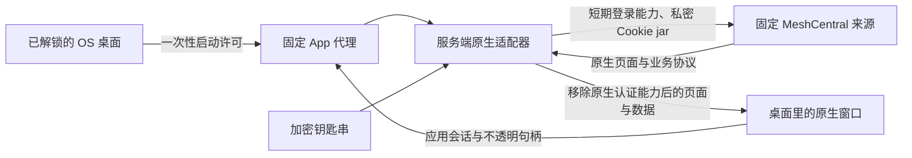

# 把远程管理接入 OS 的会话边界

**阶段状态：已上线；原生管理员身份、控制握手与桌面输入验收通过，真实设备业务待验收。** 发布后当前版本与三项服务复核通过，既有 SSO 自动续接，无需再次输入密码。真实窗口显示原生管理员身份，先前失败的脚本和图标均正常加载，控制 WebSocket 握手为 `101`。原生页面当前显示暂无设备组或在线 Agent，不能据此宣称真实远程桌面、终端或设备文件操作成功；本轮也没有重跑真实 Mesh 连接的锁定撤销。

前一阶段的[原生系统应用](12-native-system-apps.md)让资源、设备和实例状态进入桌面。本阶段进一步接入 MeshCentral 的原生管理页面与通信协议。窗口应由 OS 管理位置、焦点、生命周期和输入，项目继续执行自己的原生权限检查；给页面加一个图标，只完成了入口的一小部分。

## 一次解锁后，原站身份仍在服务端

主人先用密码与 Authenticator 解锁工作区。桌面启动 App 时交换一次性启动许可，得到与该工作区租约绑定的应用会话。服务端加密钥匙串保存经过核验的既有原站身份材料；解密发生在服务端，不能把长期密钥拼进 iframe 地址、浏览器存储或前端配置。

MeshCentral 提供原生登录 Token 与嵌入能力，具体行为需要按安装版本核对。[官方嵌入说明](https://docs.meshcentral.com/meshcentral/#embedding-meshcentral)解释了这类入口；本次适配还逐项阅读了实际安装的登录处理、Cookie 编解码、页面模板和 WebSocket 源码。仅比较包版本号不足以证明每一份安装文件都相同。

本次路线面向已核验的 1.2.5 安装，固定既有管理员身份，保留原密码、MFA 和数据库中的密钥。导入器读取原程序实际采用的配置或数据库来源，不调用可能新建密钥的便利命令，也不因某个字段不好解析而猜另一个身份来源。

原生登录能力是权限很大的凭据。适配器只在服务端生成短期、单次使用的登录能力，用它向固定原站交换会话；本次有效期为三十秒。第一次响应只用于确认登录并取得原站 Cookie，页面内容被丢弃，再用干净地址取得真正交给浏览器的页面。这样不会把登录查询参数带进用户看到的文档。原站 Cookie 组成服务端 Cookie jar，更新时也只保存在服务端。相关格式与时限规则来自[对应版本的原生 Cookie 实现](https://github.com/Ylianst/MeshCentral/blob/1.2.5/meshcentral.js)，实际部署仍要以现场文件和核验记录为准。

## 页面里的句柄不是原站 Token

原生页面还会把两类认证 Cookie 放进脚本变量，并在控制通道中更新它们。只保护 HTTP 的 `Set-Cookie` 不够：JavaScript、WebSocket 文本帧和连接地址同样可能把凭据送进浏览器。

适配器将这些值替换为随机不透明句柄。映射保存在服务端，与同一个工作区租约绑定，并区分浏览器侧认证和 Agent 侧 relay 认证。句柄不能直接登录原站，也不能跨租约兑换。原生刷新消息产生新值时，仍经过相同映射。

浏览器发起固定的 relay 请求时，代理验证路径、协议、节点与参数，再在服务端将正确类型的句柄解回原生值。原生控制连接若使用首帧认证，也必须符合已核对的固定消息结构。客户端自行提供的身份请求头、原生登录参数、重复参数和其他来源地址都不能成为授权依据。

这里必须分开对待“拥有管理员身份”与“允许页面导出凭据”。原生账号安全、登录凭据生成、服务器配置或备份导出，以及尚未审查的其他远控协议，不会因为管理员已经登录就自动开放。当前切片的管理动作仍受原站权限检查，未适配的敏感动作返回需要 OS 受管操作的明确结果。

## 锁定必须终止已经建立的连接

WebSocket 完成握手之后仍可能持续传输桌面画面、键盘输入或文件。只拒绝新的 HTTP 请求，无法证明锁定已经生效。

实现为控制和 relay 连接登记租约撤销回调与到期时间；在合成双 WebSocket 场景中，锁定会关闭浏览器侧和原站侧连接，并清除私密 Cookie jar、句柄与适配器持有的密钥缓冲。进行中的 HTTP 读取与设备下载也受中断约束。请求前、异步操作返回后和发出结果前都检查租约，避免锁定前启动的请求在锁定后继续交付内容。这部分自动测试证据与尚未重跑的生产 Mesh 锁定验收分别保留。

设备 relay 需要二进制帧，普通控制通道却不应因此获得任意二进制转发能力。实现分别限制路径、帧大小、排队字节和连接数量。设备文件下载还受总字节与时限约束，并强制作为附件返回，防止设备上的 HTML 文件在 App 来源中执行。

WebRTC 可以让数据绕过代理连接。当前路线显式关闭原站 WebRTC，页面设置与实际信令也一并限制；不能只隐藏一个按钮。这样锁定所关闭的仍是实际承载通信的通道。受控双向 WebSocket 和二进制回显测试已覆盖这些边界，真实设备上的最终业务验收仍要单独记录。

## 页面并发暴露了合成测试的缺口

接入过程中，原生主文档可以显示，部分脚本却加载失败，随后出现依赖对象未定义的错误。逐个检查后，原站资源存在、返回成功且编码正常；公开脚本放进合成适配器，也能通过。问题不应靠扩大静态路径白名单或关闭凭据保护来掩盖。

关键差异是读取钥匙串的时序。原有合成测试立即返回凭据，真实加密库却需要串行校验与文件读取，并有十六项在途操作上限。一个原生页面同时请求约四十份脚本，每个请求都单独读取同一项凭据，就可能撞到队列上限。主文档成功不代表整页启动已经成功。

修复按 App 合并同一时刻正在进行的读取，让并发调用共享一个 Promise；成功或失败后立即移除，下一次仍重新读取，不长期缓存已解密值。服务关闭时拒绝在途与后续读取，迟到的结果不再交付。原有队列上限保持不变，原生实例窗口与项目代理也共用同一个 MCS 读取入口。

回归测试因此增加了真正受十六项上限约束的凭据来源与四十份并发资源请求，并检查失败后恢复、读取结束后再次访问、跨 App 隔离和关闭行为。原生会话的固定续期路径也单独核对并测试，不能因为首页短时可用而遗漏长会话更新。修复发布后，真实浏览器中先前失败的脚本均返回 `200`，控制通道完成握手；代码检查与生产启动有各自证据。

另一个实际差异是原生模板合法省略了 `head` 标签。原有输入桥只在显式 `head` 中注入，结果页面能显示，OS 快捷键却没有进入该窗口。已发布的修复继续使用 HTMLRewriter：有真实 `head` 时保持原行为，没有 `head` 但有真实 `body` 时把固定外部桥脚本放到正文开头；已有桥则不重复插入，没有文档容器的片段保持原样。JavaScript 字符串里的伪标签不能被当作 DOM。测试模板也改成实际的省略标签形式，并把“DOM 中存在桥脚本”和“真实焦点下快捷键生效”分开验收。修复后，真实 iframe 焦点下 Ctrl＋K 已打开 OS Spotlight；原生页面白区的真实右键操作也显示万点飞花菜单，靠左并排通过。

## 不可变发行包与精确回退

发布包一旦冻结，就用固定校验值标识代码、制品和审核入口。发现兼容问题时生成新的候选，不在已经核验的包里悄悄替换文件。现有桌面版本、网关配置和钥匙串都有独立的状态，不能用“回到旧代码”代替完整回退。

尤其是钥匙串导入，可能已经写入新记录，而下一步服务检查才失败。本次发布事务在写入前停止 BFF、保存加密库原文件及其元数据；导入只允许增加目标项目记录，既有项目的密文必须保持原样。失败时先恢复精确的加密快照与元数据，再启动原发行版本，不重新生成旧凭据。原站密码、MFA、数据库和密钥不属于这次回退可以随意改写的对象。

多入口发布也要分别检查：边缘节点的 TLS 精确站点、核心节点的受保护路由、认证跳转和匿名拒绝，不能互相代替。版本指针切换、服务重启或一次 `200 OK`，都不足以证明应用管理已经正常。

## Bun 硬链接带来的兼容教训

严格读取器最初把公开包元数据和秘密文件一并要求为“不可组写、仅一个硬链接”。现场公开包元数据却由包管理器与缓存共享 inode，因而被保护检查拒绝。这种情况符合 Bun 的安装方式：[官方全局缓存说明](https://bun.sh/docs/pm/global-cache#fast-copying)介绍了 Linux 与 Windows 上的硬链接策略。

修复没有放宽通用秘密读取，也没有批量改权限。只为已经审查的公开包元数据建立一个独立入口：固定安装位置和缓存别名，要求两处恰好指向同一个 inode，检查链接数、属主、属组、精确权限、私密祖先目录与字节上限；打开时拒绝符号链接，并比较读前、文件描述符及读后两处路径的元数据。内容再经过固定 SHA 核验，只返回名称和版本两个公开字段。

这个例外不接受调用者指定路径，不适用于账号数据库、配置、主密钥或加密库。对那些文件，原先的单链接、权限与稳定性约束继续生效。包元数据的哈希也只证明这一份元数据符合预期，不能被宣传成整个安装包或运行进程的完整性证明。

## 已验收的范围与尚未完成

最终 Bun 测试为 250 项通过、0 失败、3286 项断言；Windows 的 13 项 POSIX 权限用例明确跳过，不能把跳过项计为通过。自动协议测试、生产页面观察和真实用户输入分别记录。

| 项目 | 本章当前证据范围 |
| --- | --- |
| 适配器与协议 | 已核对安装源契约；合成测试覆盖原生登录格式、私密 jar、页面和刷新消息的句柄映射、伪造身份拒绝 |
| 公网原生身份与资源 | 既有 SSO 自动续接，无需再输入密码；真实原生页面显示管理员身份，先前失败脚本及图标均返回 `200` |
| 控制连接 | 生产浏览器的控制 WebSocket 完成 `101` 握手；页面明确显示没有设备组或在线 Agent |
| OS 输入与布局 | 真实 iframe 焦点下 Ctrl＋K 打开 Spotlight，原生白区右键出现 OS 菜单，靠左并排通过 |
| 窗口连续性 | 本阶段前次发布已实测最小化与 Dock 恢复前后为同一个 iframe DOM 节点，恢复后焦点仍在 iframe；本次沿用该实现，不把节点一致等同长期连接稳定 |
| 设备 relay 与锁定 | 本地双 WebSocket 受控合成回显、二进制及撤销关闭已测试；本轮未重跑生产 Mesh 锁定，不能当作真实设备业务通过 |
| 导入与文件边界 | Windows 与 Linux 合成检查，以及公开包元数据的现场只读检查已有通过证据；不公开秘密内容 |
| 生产发布 | 已自动发布，当前发行与三项服务的独立检查通过；本章不公开发行标识、原始回执或基础设施输入 |
| 真实在线设备与其他协议 | 当前没有在线 Agent，远程桌面、终端执行、设备文件上传或下载仍待验收；Commander 等未审查入口保持受限 |

后续记录应明确当时的发行版本、测试类型和实际触发的操作。页面能加载、设备列表为空、协议握手成功、画面出现和执行了远程操作，是不同的证据。原站调试输出与发布回执按私密材料处理，公开手册重新撰写过程，不粘贴原始日志。

继续阅读：[钥匙串与多桌面](08-keychain-and-spaces.md)、[日常运维与发布流程](04-operations.md)及[文档公开流程](06-publication-process.md)。
